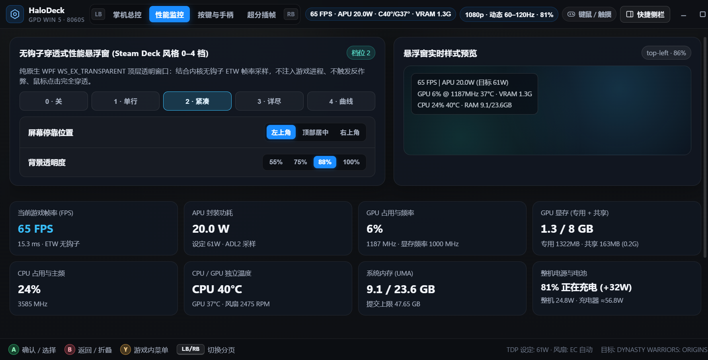
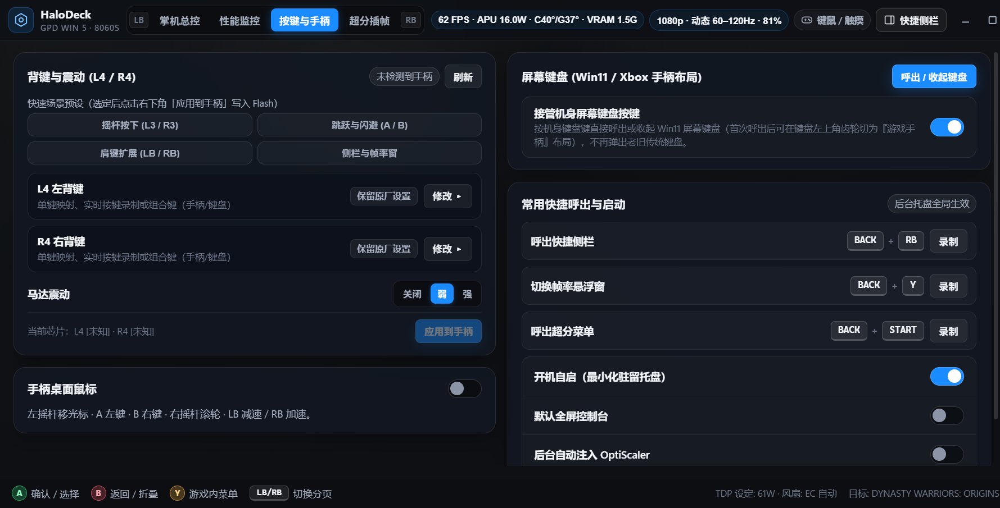
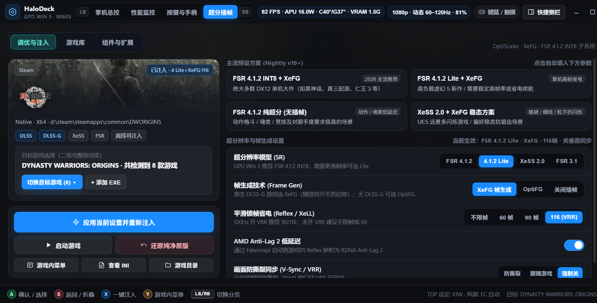
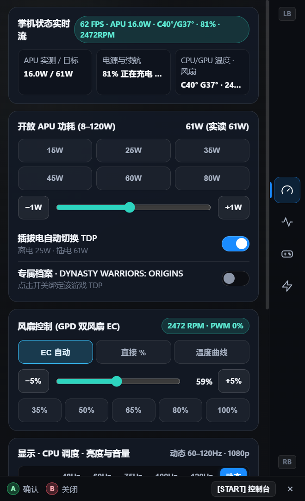
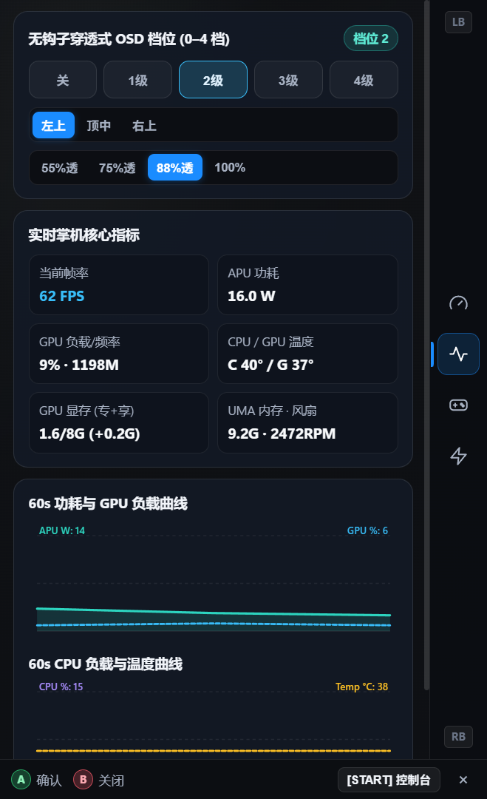
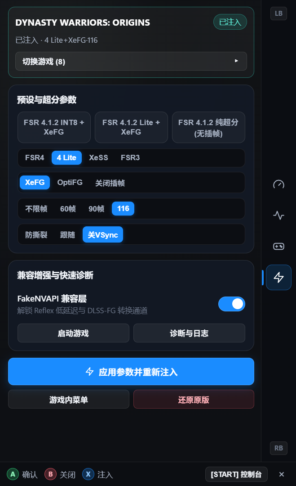

<div align="center">

# HaloDeck

**专为 GPD Win 5 (AMD Strix Halo / Radeon 8060S) 打造的 Windows 掌机总控台、440px 游戏内快捷侧栏 (QAM) 与 OptiScaler FSR 4 / XeFG 管理器**

[](https://github.com/Lokilankaaa/HaloDeck/releases)
[](LICENSE)
[](HaloDeck.sln)
[](#核心特性)

</div>

HaloDeck 面向 **GPD Win 5** 等高功耗 AMD Strix Halo Windows 掌机深度定制，将底层硬件直控、无钩子 ETW 帧率悬浮窗、GPD 手柄背键编程与 **OptiScaler (FSR 4.1.2 / XeSS 2.0 / XeFG)** 超分插帧管理整合为一体，提供 **1200×640 主控台** 与 **440px 快捷侧栏 (QAM)** 双端一致体验，全程支持手柄 (`A / B / X / Y / LB / RB`) 与触屏滑动操作。

---

## 界面概览

> 以下全部为纯应用窗口实拍截图，无桌面背景干扰。

### 掌机总控台 (`HaloDeck Console`)


<table>
  <tr>
    <td width="50%" align="center">
      <br />
      <sub><b>性能监控与穿透 HUD</b> · 无钩子 ETW 帧率采样与 Steam Deck 风格 0–4 档浮窗</sub>
    </td>
    <td width="50%" align="center">
      <br />
      <sub><b>按键与手柄</b> · L4/R4 组合键与录制、Win11 软键盘接管与热键映射</sub>
    </td>
  </tr>
  <tr>
    <td width="50%" align="center">
      <br />
      <sub><b>超分插帧调优</b> · FSR 4.1.2 INT8/Lite · XeSS 2.0 · XeFG / OptiFG 与 Anti-Lag 2</sub>
    </td>
    <td width="50%" align="center">
      <br />
      <sub><b>Steam 游戏库海报墙</b> · 多磁盘游戏识别、封面缓存、反作弊标注与一键切换</sub>
    </td>
  </tr>
</table>

### 440px 游戏内快捷侧栏 (`Quick Access Menu`)

<table>
  <tr>
    <td width="25%" align="center">
      <br />
      <sub><b>掌机快调</b><br />1W 步进 TDP / 风扇 / DRR</sub>
    </td>
    <td width="25%" align="center">
      <br />
      <sub><b>性能浮窗</b><br />OSD 档位与 60s 曲线</sub>
    </td>
    <td width="25%" align="center">
      <br />
      <sub><b>按键与软键盘</b><br />背键方案 / TabTip / 鼠标</sub>
    </td>
    <td width="25%" align="center">
      <br />
      <sub><b>游戏内超分</b><br />预设快切与重注入</sub>
    </td>
  </tr>
</table>

---

## 核心特性

### 1. 开放功耗、风扇与 CPU 调度
- **开放 TDP 调控 (`8W–120W`)**：支持 **1W 精细步进微调**、滑块即时数值预览与自定义功耗快捷标签；支持 **插拔电自动切换 TDP** 与 **按当前前台游戏绑定专属功耗档案**。
- **GPD 双风扇 EC 控制**：经签名 `PawnIO` 内核驱动直写 SMU/EC 寄存器，支持 **EC 自动**、**直接百分比** 与 **四点温度安全曲线** 三种模式。
- **CPU 睿频与频点上限**：提供关睿频 / 平衡 / 满血调度，并支持限制 CPU 最大主频以将功耗预算优先让渡给 Radeon 8060S 核显。

### 2. 实时整机电源流与三态续航估算
- **消除 BMS 滞后**：通过即时追踪 APU 封装功耗变化并与电池 BMS 基准滤波融合，在游戏突发负载变化时快速反映整机运行功耗。
- **三态电源精确计算**：
  - **电池放电**：依据当前实际放电功率精确计算剩余续航时间；
  - **快充 / 供电充足**：充电功率高于整机运行功率时自动切换为充电状态并估算充满时间；
  - **边充边玩反向掉电**：充电器功率不足以覆盖整机运行时，自动按净电池放电速率实时给出剩余续航。

### 3. 显示刷新率 (`DRR / VRR`) 与无钩子性能监控
- **原生 Win11 动态刷新率协同**：一键切换 `48 / 60 / 75 / 100 / 120Hz` 或同步 Windows 11 `DRR`（`60–120Hz` / `48–120Hz VRR` 自适应），并支持 `1080p / 900p / 720p` 分辨率与平滑亮度、音量调节。
- **零注入 ETW 性能采样与穿透 HUD**：基于 Windows 内核 ETW `PresentMon` 采样帧时间，不向游戏进程注入钩子、不触发反作弊；配合 `WS_EX_TRANSPARENT` 鼠标完全穿透顶层浮窗，提供 Steam Deck 风格 `0–4` 档显示与 60 秒实时负载/温度曲线。

### 4. GPD Win 5 背键编程与系统软键盘接管
- **L4 / R4 HID 固件直写**：直接读取并写入 GPD Win 5 手柄 Flash 配置，支持 **单键选择**、**实时按键录制** 与 **双键组合宏**（涵盖 Xbox 手柄按键与键盘组合）。
- **Win11 触摸/手柄软键盘接管**：开启后可拦截机身物理键盘按键并呼出或收起 Windows 11 原生 `TabTip` 软键盘，避免弹出老旧传统键盘；同时内置手柄桌面鼠标模拟与全局热键录制。

### 5. OptiScaler 超分插帧无损管理与反作弊保护
- **掌机实测预设方案**：内置针对 Strix Halo 调优的 **FSR 4.1.2 INT8**、**FSR 4.1.2 Lite**、**XeSS 2.0** 与 **XeFG / OptiFG** 插帧组合，并集成 `Fakenvapi` 自动将游戏内 Reflex 映射为 **AMD Anti-Lag 2**。
- **反作弊守护与无损还原**：自动扫描 Steam 全部盘符构建本地海报墙，识别 `Easy Anti-Cheat (EAC)` / `BattlEye` 等内核反作弊游戏并主动拦截后台自动注入；所有注入操作均以 SHA-256 备份原始 DLL，支持随时一键还原纯净原版。

---

## 安装与使用

### 方式一：下载绿色便携版（推荐）
1. 前往 [**GitHub Releases**](https://github.com/Lokilankaaa/HaloDeck/releases) 下载最新版本的 **`HaloDeck-win-x64-portable.zip`**。
2. 解压至任意非临时目录，双击运行 **`HaloDeck.exe`** 即可使用（首次启用底层硬件直控或服务安装时会按需请求权限）。
3. 已有旧版配置、组件包与游戏注入索引将在首次启动时自动平滑迁移至 `%LOCALAPPDATA%\HaloDeck`。

### 方式二：源码构建与一键部署
环境要求：**Windows 10 / 11 x64**、[.NET 8 SDK](https://dotnet.microsoft.com/download/dotnet/8.0)、WebView2 Runtime（Windows 11 默认内置）。

```powershell
git clone https://github.com/Lokilankaaa/HaloDeck.git
cd HaloDeck

# 构建与运行测试
dotnet build HaloDeck.sln -c Release
dotnet test HaloDeck.sln -c Release

# 可选：发布自包含便携版并安装至本地及开始菜单
powershell -ExecutionPolicy Bypass -File .\scripts\install-local.ps1
```

### 常用启动参数

| 参数 | 说明 |
| :--- | :--- |
| `--minimized` | 静默启动并驻留系统托盘 |
| `--qam` | 直接呼出或切换 440px 快捷侧栏 |
| `--install-hw-service` | 安装 `HaloDeckHardwareSvc` (Session 0 守护服务，之后切换 TDP / 风扇免 UAC 弹窗) |
| `--uninstall-hw-service` | 停止并卸载 `HaloDeckHardwareSvc` 守护服务 |

---

## 项目结构

```text
HaloDeck/
├── HaloDeck.sln                     # .NET 8 解决方案
├── src/
│   ├── HaloDeck.Core/               # 核心库：SMU/EC/HID 硬件通信、电源估算、ETW FPS、OptiScaler 注入引擎
│   └── HaloDeck.App/                # WPF 宿主、WebView2 双端视图、穿透 HUD、托盘与 Session 0 服务
├── tests/
│   └── HaloDeck.Tests/              # xUnit 单元测试与注入/还原/电源/编解码集成测试
├── scripts/
│   └── install-local.ps1            # 本地自包含发布、快捷方式与卸载脚本生成
└── docs/screenshots/                # 纯窗口文档展示截图
```

---

## 开源协议与致谢

本项目基于 **[MIT License](LICENSE)** 开源。

感谢以下开源项目提供底层驱动与超分生态基础：
- [PawnIO](https://github.com/namazso/PawnIO) · [OptiScaler](https://github.com/optiscaler/OptiScaler) · [Fakenvapi](https://github.com/FakeMichau/fakenvapi)
