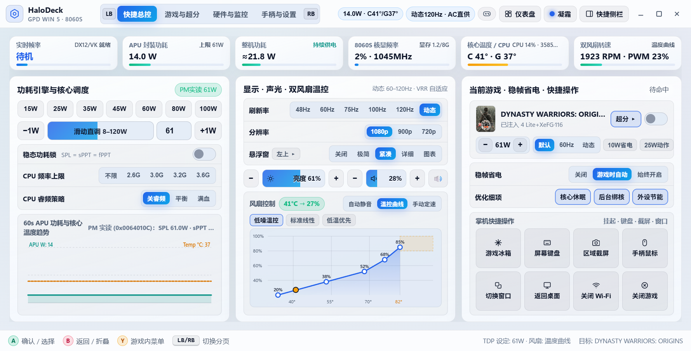
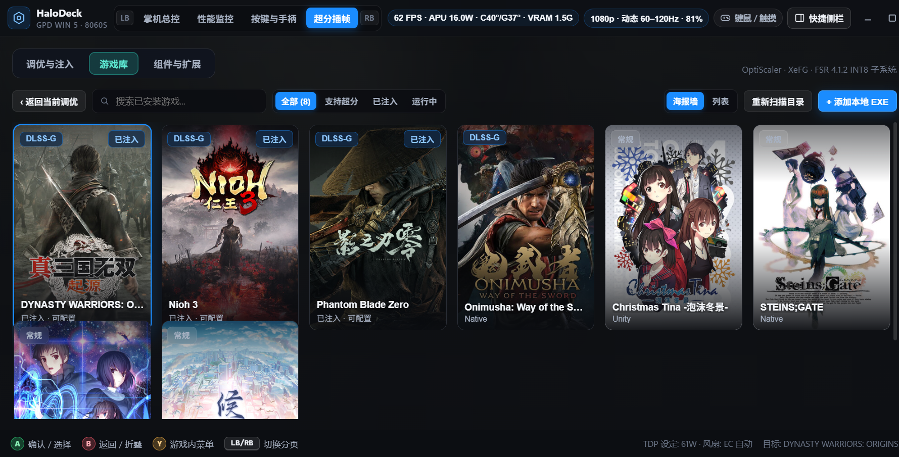
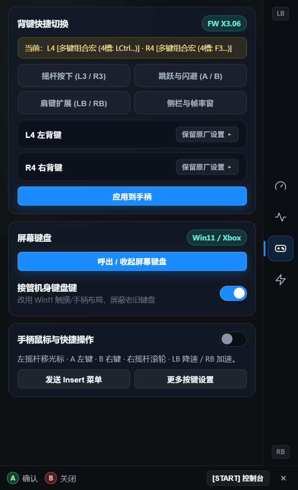

<div align="center">

# HaloDeck

**专为 GPD Win 5 (AMD Strix Halo / Radeon 8060S) 打造的 Windows 掌机总控台、440px 游戏内快捷侧栏 (QAM)、OptiScaler 超分管理器与社区插件平台**

[](https://github.com/Lokilankaaa/HaloDeck/releases)
[](LICENSE)
[](HaloDeck.sln)
[](#核心特性)

</div>

HaloDeck 面向 **GPD Win 5** 等高功耗 AMD Strix Halo Windows 掌机深度定制，将底层硬件直控、无钩子 ETW 帧率悬浮窗、GPD 手柄背键固件编程、**OptiScaler (FSR 4.1.2 / XeSS 2.0 / XeFG)** 超分插帧管理以及 **Decky 风格社区插件生态** 整合为一体。应用提供 **1200×640 主控台** 与 **440px 快捷侧栏 (QAM)** 双端一致体验，全程支持手柄 (`方向键 / A / B / X / Y / LB / RB`) 与触屏操作。

---

## 界面概览

> 以下全部为纯应用窗口实拍截图，内置 **掌机大磁贴 (`Bento`) / 桌面仪表盘 (`Cockpit`)** 双结构布局与 **极光深色 (`Aurora`) / 凝霜浅色 (`Frost`)** 双配色，首页与右侧快捷侧栏 (`QAM`) 均保持 **一屏零纵向滚动**。

### 掌机总控台 (`HaloDeck Console`)

<table>
  <tr>
    <td width="50%" align="center">
      <br />
      <sub><b>快捷总控 · 掌机大磁贴 (Bento)</b> · 大触控胶囊滑条、单游专属绑定与三合一模式快切</sub>
    </td>
    <td width="50%" align="center">
      <br />
      <sub><b>快捷总控 · 桌面仪表盘 (Cockpit)</b> · 顶部动态负载条、60s 功耗曲线与风扇温控曲线预览</sub>
    </td>
  </tr>
  <tr>
    <td width="50%" align="center">
      <br />
      <sub><b>游戏与超分</b> · 单游戏专属 TDP/刷新率/次基频 + FSR 4.1.2 / XeSS 2.0 / XeFG 一站式配置</sub>
    </td>
    <td width="50%" align="center">
      <br />
      <sub><b>Steam 游戏库海报墙</b> · 多磁盘游戏识别、封面缓存、反作弊标注与一键切换</sub>
    </td>
  </tr>
  <tr>
    <td width="50%" align="center">
      <br />
      <sub><b>硬件与监控</b> · 双风扇 5 点 SVG 温控曲线、CPU 次基频分配与无钩子穿透 HUD</sub>
    </td>
    <td width="50%" align="center">
      <br />
      <sub><b>手柄与设置</b> · L4/R4 固件编程、Win11 软键盘接管与双布局/双配色切换</sub>
    </td>
  </tr>
</table>

### 440px 游戏内快捷侧栏 (`Quick Access Menu` · 首屏零滚动)

<table>
  <tr>
    <td width="25%" align="center">
      <br />
      <sub><b>快捷总控</b><br />TDP / 声光 / OSD / 游戏冰箱</sub>
    </td>
    <td width="25%" align="center">
      <br />
      <sub><b>游戏与超分</b><br />预设快切与一键重注入</sub>
    </td>
    <td width="25%" align="center">
      <br />
      <sub><b>硬件与浮窗</b><br />传感器、次基频与 60s 曲线</sub>
    </td>
    <td width="25%" align="center">
      <br />
      <sub><b>手柄与偏好</b><br />背键方案 / 软键盘 / 主题</sub>
    </td>
  </tr>
</table>

---

## 核心特性

### 1. 开放功耗、稳态锁、稳帧省电与双风扇温控
- **开放 TDP 调控 (`8W–120W`) 与稳态功耗锁 (`SPL = sPPT = fPPT`)**：支持 **1W 精细步进微调**、一键锁定瞬时功耗脉冲、插拔电自动切换瓦数，以及 **按单款游戏独立绑定专属 TDP + 刷新率 + CPU 限频**（启动游戏自动接管，退出恢复全局）。
- **无钩子稳帧省电引擎 (`Steady Eco Mode`)**：零进程注入、反作弊友好，支持空闲核心 CC6 深睡、后台非游戏进程收敛绑定尾核与外设闲置节能；针对关闭睿频场景内置 **`2.6G / 3.0G / 3.2G` 次基频甜点限频**，在锁死 TDP 下为 Radeon 8060S 核显分配更多功耗预算。
- **GPD 双风扇 EC 控制**：经签名 `PawnIO` 内核驱动直写 SMU/EC 寄存器，支持 **自动静音**、**手动定速 %** 与 **5 点可编辑 SVG 温控曲线**。
- **Session 0 硬件守护服务 (`HaloDeckHardwareSvc`)**：安装后日常调节 TDP 与风扇免 UAC 弹窗，并支持原生 Windows 任务计划开机自启。

### 2. 实时整机电源流与三态续航估算
- **瞬态功耗融合估算**：结合 APU 封装功耗变化与电池 BMS 基准滤波，在游戏负载切换时即时反映整机运行功耗。
- **三态电源精确计算**：
  - **电池放电**：依据当前实际放电功率实时估算剩余续航时间；
  - **快充 / 供电充足**：充电功率高于整机运行功率时自动切换为充电状态并估算充满时间；
  - **边充边玩净放电**：充电器功率低于整机运行时，按净电池放电速率实时显示剩余续航。

### 3. 显示刷新率 (`DRR / VRR`)、无钩子性能监控与按需提权穿透
- **原生 Win11 动态刷新率协同**：一键切换 `48 / 60 / 75 / 100 / 120Hz` 或同步 Windows 11 `DRR`（`60–120Hz` / `48–120Hz VRR` 自适应），并支持 `1080p / 900p / 720p` 分辨率与平滑亮度、音量调节。
- **零注入 ETW 性能采样与穿透 HUD**：基于 Windows 内核 ETW `PresentMon` 采样帧时间，不向游戏进程注入钩子；配合 `WS_EX_TRANSPARENT` 鼠标完全穿透顶层浮窗，提供 Steam Deck 风格 `0–4` 档显示与 60 秒实时负载/温度曲线。
- **默认普通权限运行 + 按需单次临时提权**：日常启动保持普通用户权限，与 **Steam 大屏幕模式** 无缝兼容；当游玩以管理员身份运行的游戏需要侧栏或 OSD 穿透时，可在 **OSD 悬浮窗设置**、**按键与设置** 或 **QAM 侧栏** 中一键触发单次临时提权，下次启动自动恢复普通权限。

### 4. GPD Win 5 背键固件编程与系统软键盘接管
- **L4 / R4 HID 固件直写**：直接读写 GPD Win 5 手柄内部 Flash 配置，支持 **全键盘单键选择**、**实时按键录制**、**双键组合宏** 与 **一键恢复出厂 (`NC`)**，主控台与 QAM 侧栏实时双向同步。
- **Win11 触摸/手柄软键盘接管**：支持拦截机身物理键盘按键以呼出或收起 Windows 11 原生 `TabTip` 软键盘；同时内置手柄桌面鼠标模拟与全局热键录制。

### 5. OptiScaler 超分插帧无损管理与反作弊保护
- **掌机实测预设方案**：内置针对 Strix Halo 调优的 **FSR 4.1.2 INT8**、**FSR 4.1.2 Lite**、**XeSS 2.0** 与 **XeFG / OptiFG** 插帧组合，并集成 `Fakenvapi` 自动将游戏内 Reflex 映射为 **AMD Anti-Lag 2**。
- **反作弊守护与无损还原**：自动扫描 Steam 全部盘符构建本地海报墙，识别 `Easy Anti-Cheat (EAC)` / `BattlEye` 等内核反作弊游戏并主动拦截后台自动注入；所有注入操作均以 SHA-256 备份原始 DLL，支持随时一键还原纯净原版。

### 6. 社区插件生态与安全商店（Decky 风格）
- **零服务器插件商店 + 双端无缝挂载**：可在主界面 **「插件扩展」** 与侧边栏 **🔌 插件抽屉** 中按分类筛选、搜索、查看源码与权限详情、一键批量更新与卸载插件；支持 **官方纯净商店**、**第三方社区 `store.json` 源订阅**、**GitHub `owner/repo` 链接直装**、**可选 GitHub 下载镜像加速** 与 **本地 `.zip` / 目录直导**。
- **内置手柄自动导航、双主题联动与开发者模式**：宿主提供的 `plugin-sdk.js` 内建掌机手柄空间导航（方向键移动焦点、`A` 确认、`B` 返回、左右调节滑块），并自动将主界面深/浅双主题（`Aurora` / `Frost`）及自定义皮肤 CSS 变量同步到插件内；开启 **🛠 开发者模式** 后支持本地目录同步、一键重载界面与重启独立后端。
- **官方精选内置插件**：
  - **视觉主题工坊 (`halodeck.skin-studio`)**：Decky CSS Loader 风格全局换肤，提供 6 套掌机配色方案、圆角风格与自定义强调色调色板，停用自动还原原生界面；
  - **掌机游玩计时与游戏备忘 (`halodeck.game-notes`)**：自动追踪每款游戏的累计游玩时长、启动次数与最近游玩时间，并按游戏保存键位提醒、TDP/超分推荐与攻略备忘；
  - **硬件曲线与一键诊断报告 (`halodeck.backend-demo`)**：实时绘制 APU 功耗与温度曲线，通过独立 JSON-RPC 后端进程一键导出硬件与游戏库诊断报告。
- **多层安全隔离**：
  - 纯前端插件运行在受限 `iframe` 沙箱中；独立后端进程通过 `stdio JSON-RPC 2.0` 通信并绑定 Win32 Job Object 随主程序退出自动销毁；
  - 新装插件默认停用，启用前需显式确认权限清单；版本更新若出现**权限升级**自动撤回授权并要求重新确认；官方商店支持 `revokedIds` 远程熔断下架。

---

## 社区插件开发、打包、验证与发布指南

完整的 SDK API 文档请查阅 [**`docs/PLUGIN_SDK.md`**](docs/PLUGIN_SDK.md)，可参考 [`examples/plugins/`](examples/plugins/) 目录下的 3 个官方插件实现。

### 1. 目录规范与打包（如何打包）

每个插件以唯一 `id` 命名（3–64 位小写字母、数字及 `. _ -`），目录结构如下：

```text
author.my-plugin/
├── plugin.json         # 必需：插件清单（id、版本、挂载点、权限声明、后端配置）
├── icon.svg            # 可选：插件图标（SVG / PNG）
├── ui/
│   └── index.html      # 必需：前端入口，引入 https://app.halodeck.local/plugin-sdk.js
└── backend/            # 可选：独立 stdio JSON-RPC 2.0 后端进程
    └── worker.ps1      # 或编译生成的 .exe / .cmd
```

使用仓库内置的一键校验与打包脚本（自动执行与官方 Decky CI 一致的清单验证、零二进制检查与静态安全扫描，并生成 `.zip` 与 `SHA-256`）：

```powershell
powershell -ExecutionPolicy Bypass -File .\scripts\pack-plugin.ps1 -PluginDir .\author.my-plugin
```

### 2. 本地验证（如何验证）

发布前建议按以下清单在本地 HaloDeck 中完成验收：

1. **本地调试与导入**：打开 HaloDeck → **「插件扩展」**，开启右上角 **「🛠 开发者模式」** 后可直接 **「导入本地目录」** 快速迭代（支持一键 **重载** 前端与 **重启后端**），最终使用 **「导入本地 .zip」** 验证成品包安装与权限弹窗。
2. **双端与双主题验收**：分别在 **主界面插件中心** 与 **440px QAM 侧栏插件抽屉** 打开插件，切换 **极光深色 (`Aurora`)** 与 **凝霜浅色 (`Frost`)** 主题，确认排版自适应且文字/控件对比度清晰。
3. **掌机手柄验收**：全程使用手柄方向键、`A` 确认、`B` 返回与滑块调节，确认所有按钮与输入控件均可正常聚焦和操作（建议在自定义弹窗/下拉组件上优先使用纯 DOM 组件以确保 QAM 无焦点窗口下稳定交互）。
4. **权限与后端日志核查**：确认 `plugin.json` 遵循最小权限原则；若包含独立后端，可在插件卡片点击 **「日志」** 查看 `stderr` 输出并确认停用/退出后子进程正常回收。

### 3. 发布与上架（如何发布）

HaloDeck 支持 **官方纯净商店投稿（Decky 审核模式）** 与 **社区独立分发** 两种方式：

#### 方式 A：提交上架官方纯净商店（Decky 风格开源审核）
为最大程度保障用户安全，官方纯净商店采用 **「强制开源仓库 + 锁定 40 位 Commit SHA + 禁止夹带预编译二进制 + GitHub Actions 干净环境重编译校验」** 流程（详见 [`plugins/submissions/README.md`](plugins/submissions/README.md)）：

1. **开源托管**：将插件完整源码推送至公开 GitHub 仓库（不得包含预编译 `.exe` / `.dll` / `.sys` 等闭源二进制；编译型后端将由 CI 从源码构建）。
2. **提交登记清单**：Fork 本仓库，在 `plugins/submissions/` 目录下新增或更新 `<你的插件ID>.json`，强制锁定不可变的 40 位 `commit` SHA：
   ```json
   {
     "id": "author.my-plugin",
     "repo": "https://github.com/author/halodeck-my-plugin",
     "commit": "0123456789abcdef0123456789abcdef01234567",
     "subpath": ".",
     "category": "utility"
   }
   ```
3. **CI 自动验证与报告**：向 `Lokilankaaa/HaloDeck` 发起 Pull Request 后，[`.github/workflows/verify-plugin-store.yml`](.github/workflows/verify-plugin-store.yml) 会自动拉取指定 `commit`，校验 `plugin.json` 规范、扫描黑盒二进制与高危混淆脚本，在干净环境中编译打包生成 `.zip` 与 `SHA-256`，并自动在 PR 下发表结构化安全审核报告。
4. **合并即全自动上架**：维护者完成代码 diff 审核并合并 PR 后，[`.github/workflows/publish-plugin-store.yml`](.github/workflows/publish-plugin-store.yml) 自动在干净环境重编译、发布至 `plugin-store-builds` Release 并同步写入 `plugins/store.json`，通过 CDN 自动推送至全球 HaloDeck 客户端。

#### 方式 B：社区独立分发（无需提交官方审核）
- **GitHub 仓库直装**：将插件 `.zip` 上传至自己仓库的 GitHub Release，用户直接在 HaloDeck **「插件扩展 → 链接 / GitHub 直装」** 输入 `owner/repo` 或 `.zip` 链接即可安装。
- **第三方商店源 (`store.json`)**：在 GitHub / Gitee 托管静态 `store.json`（格式参考 [`plugins/store.json`](plugins/store.json)），用户在 **「插件商店 → + 订阅源」** 粘入链接即可订阅与自动检测更新。

---

## 安装与使用

### 方式一：下载绿色便携版（推荐）
1. 前往 [**GitHub Releases**](https://github.com/Lokilankaaa/HaloDeck/releases) 下载最新版本的 **`HaloDeck-win-x64-portable.zip`**。
2. 解压至任意非临时目录，双击运行 **`HaloDeck.exe`** 即可使用（日常以普通权限运行，仅在安装硬件守护服务或按需提权穿透时请求管理员权限）。
3. 旧版配置、组件包与游戏注入索引将在首次启动时自动迁移至 `%LOCALAPPDATA%\HaloDeck`。

### 方式二：源码构建与一键部署
环境要求：**Windows 10 / 11 x64**、[.NET 8 SDK](https://dotnet.microsoft.com/download/dotnet/8.0)、WebView2 Runtime（Windows 11 默认内置）。

```powershell
git clone https://github.com/Lokilankaaa/HaloDeck.git
cd HaloDeck

# 构建与运行测试
dotnet build HaloDeck.sln -c Release
dotnet test HaloDeck.sln -c Release

# 可选：发布自包含便携版并安装至本地及开始菜单
powershell -ExecutionPolicy Bypass -File .\scripts\install-local.ps1
```

### 常用启动参数

| 参数 | 说明 |
| :--- | :--- |
| `--minimized` | 静默启动并驻留系统托盘 |
| `--qam` | 直接呼出或切换 440px 快捷侧栏 |
| `--install-hw-service` | 安装 `HaloDeckHardwareSvc` (Session 0 守护服务，之后切换 TDP / 风扇免 UAC 弹窗) |
| `--uninstall-hw-service` | 停止并卸载 `HaloDeckHardwareSvc` 守护服务 |

---

## 项目结构

```text
HaloDeck/
├── HaloDeck.sln                     # .NET 8 解决方案
├── src/
│   ├── HaloDeck.Core/               # 核心库：SMU/EC/HID 硬件通信、电源估算、ETW FPS、OptiScaler 注入与插件引擎
│   └── HaloDeck.App/                # WPF 宿主、WebView2 双端视图、穿透 HUD、托盘与 Session 0 服务
├── tests/
│   └── HaloDeck.Tests/              # xUnit 单元测试与注入/还原/电源/背键/插件安全集成测试
├── examples/plugins/                # 官方精选社区插件源码模板（视觉主题工坊 / 游玩计时与备忘 / 硬件曲线诊断）
├── plugins/
│   ├── store.json                   # 官方纯净插件商店索引
│   └── submissions/                 # Decky 模式官方商店 PR 投稿清单与审核规范
├── .github/workflows/               # 自动构建发布与社区插件源编译安全核验 CI
├── scripts/
│   └── install-local.ps1            # 本地自包含发布、快捷方式与卸载脚本生成
└── docs/
    ├── PLUGIN_SDK.md                # 社区插件 SDK 与 JSON-RPC 后端开发手册
    └── screenshots/                 # 纯窗口文档展示截图
```

---

## 开源协议与致谢

本项目基于 **[MIT License](LICENSE)** 开源。

感谢以下开源项目提供底层驱动与超分生态基础：
- [PawnIO](https://github.com/namazso/PawnIO) · [OptiScaler](https://github.com/optiscaler/OptiScaler) · [Fakenvapi](https://github.com/FakeMichau/fakenvapi)
