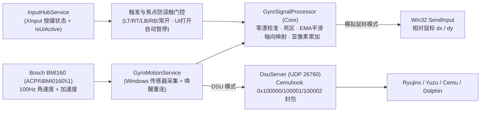

# HaloDeck v0.6.2 规划方案：内置零驱动陀螺仪引擎（BMI160）

## 1. 目标与架构定位

在 **零第三方内核驱动、100% 反作弊纯净** 的前提下，直接对接 GPD Win 5 机身内置的 **Bosch BMI160 6 轴 IMU（`ACPI\BMI0160\1`，已实测支持 100 Hz 原生上报）**，为 HaloDeck 补齐掌机用户最常用的两大体感刚需：

1. **体感模拟鼠标（FPS / 第三人称射击开镜微瞄）**：通过 Win32 `SendInput` 输出亚像素级平滑相对位移，零驱动延迟、与 `InputHubService` 共享 XInput 按键状态，呼出 HaloDeck 主窗口或 QAM 侧栏时自动暂停防误触。
2. **内置 DSU / Cemuhook 体感服务端（`UDP 26760`）**：标准 6 轴体感流直接对接 **Ryujinx / Yuzu / Cemu / Dolphin** 等模拟器，塞尔达射箭等体感玩法开箱即用。
3. **单游戏专属绑定**：接入现有 `PerGameProfiles`，启动不同游戏自动切换陀螺仪模式（关闭 / 模拟鼠标 / DSU）与灵敏度倍率，退出自动恢复全局。

> [!NOTE]
> **边界划分**：需要安装 `ViGEmBus` + `HidHide` 双内核驱动的「模拟 Xbox 右摇杆 / 虚拟 DualShock 4」方案不绑入 HaloDeck 本体，保持主程序零多余驱动与反作弊安全口碑，留作后续可选社区插件扩展。

---

## 2. 系统架构与数据流



### 核心设计要点

- **零额外依赖采集方案**：
  - 优先采用 Windows 原生 **COM `ISensorManager`**（`SensorsApi.dll`），保持 `HaloDeck.App.csproj` 为 `net8.0-windows`，**0 新增 NuGet / 0 体积膨胀**；
  - 开发第一步先在你的 Win 5 实机上跑一次实测脚本，校验 COM 100Hz 采样稳定性以及 **横屏正常握持下 X / Y / Z 三轴与正负号对应关系**（若 COM 采样率不及 WinRT，再评估 `net8.0-windows10.0.19041.0`）。
- **算法层下沉至 `HaloDeck.Core`（纯逻辑、全单测覆盖）**：
  - [GyroSignalProcessor.cs](file:///c:/Users/limboww/Downloads/custopti/src/HaloDeck.Core/Services/GyroSignalProcessor.cs)：
    - **静止自动校准**：采集 1.5–2 秒静止样本计算三轴零漂偏置（`BiasX / BiasY / BiasZ`），持久化写入 `settings.json`，并支持随时一键重校；
    - **水平轴向模式**：支持 **Yaw（左右转机身，掌机最常用）**、**Roll（方向盘倾斜）**、**Combined（Yaw + Roll 混合，兼顾躺玩与坐玩角度）**；
    - **死区 + 紧致低通滤波 + 亚像素余数累加**：过滤微手抖同时确保极慢速微瞄不丢像素，X/Y 灵敏度与轴反转独立可调。
  - [DsuProtocolCodec.cs](file:///c:/Users/limboww/Downloads/custopti/src/HaloDeck.Core/Services/DsuProtocolCodec.cs)：
    - 完整实现标准 Cemuhook / DSU 二进制协议（`DSUS` 魔数、CRC32 校验、版本查询 `0x100000`、槽位信息 `0x100001`、6 轴实时数据帧 `0x100002`，包含 3 轴加速度 `g`、3 轴角速度 `deg/s` 与微秒级单调时间戳）。

---

## 3. 配置模型与单游戏档案扩展

### 3.1 新增全局配置（[AppSettings.cs](file:///c:/Users/limboww/Downloads/custopti/src/HaloDeck.Core/Models/AppSettings.cs)）

```csharp
public sealed class GyroSettings
{
    public string Mode { get; set; } = "off";               // "off" | "mouse" | "dsu" | "both"
    public string Activation { get; set; } = "lt";          // "lt" | "rt" | "lb" | "rb" | "ls" | "rs" | "always" | "lt_pause"
    public string HorizontalAxis { get; set; } = "yaw";     // "yaw" | "roll" | "combined"
    public double SensitivityX { get; set; } = 1.0;         // 0.1 ~ 5.0
    public double SensitivityY { get; set; } = 1.0;         // 0.1 ~ 5.0
    public double DeadzoneDegPerSec { get; set; } = 0.8;    // 0.0 ~ 5.0 °/s
    public double Smoothing { get; set; } = 0.25;           // 0.0 (原始零平滑) ~ 0.85
    public bool InvertX { get; set; } = false;
    public bool InvertY { get; set; } = false;
    public int DsuPort { get; set; } = 26760;
    public double BiasX { get; set; } = 0.0;
    public double BiasY { get; set; } = 0.0;
    public double BiasZ { get; set; } = 0.0;
}
```

### 3.2 单游戏档案扩展（`GamePerformanceProfile`）

- `GyroModeOverride`：`""`（跟随全局）| `"off"` | `"mouse"` | `"dsu"` | `"both"`
- `GyroSensitivityScale`：`1.0`（相对全局灵敏度的单游戏微调倍率，范围 `0.3 ~ 2.5`）
- 与现有 `RunningGameTracker` / `WebUiBridge` 联动：进入游戏自动应用该游戏的陀螺仪模式，退出游戏自动切回全局设置。

---

## 4. 文件改动清单

| 模块 | 文件路径 | 职责说明 |
| :--- | :--- | :--- |
| **Core 模型** | [src/HaloDeck.Core/Models/AppSettings.cs](file:///c:/Users/limboww/Downloads/custopti/src/HaloDeck.Core/Models/AppSettings.cs) | 新增 `GyroSettings` 与 `GamePerformanceProfile` 陀螺仪覆写字段 |
| **Core 算法** | `src/HaloDeck.Core/Services/GyroSignalProcessor.cs` *(新增)* | 静止校准状态机、死区/平滑滤波、Yaw/Roll 映射、亚像素位移累加 |
| **Core 协议** | `src/HaloDeck.Core/Services/DsuProtocolCodec.cs` *(新增)* | Cemuhook / DSU 协议 CRC32 与 `0x100000/100001/100002` 二进制编解码 |
| **App 原生服务** | `src/HaloDeck.App/Native/GyroMotionService.cs` *(新增)* | 100Hz BMI160 采集、XInput 触发联动、`SendInput` 输出、DSU UDP 服务端与休眠恢复 |
| **App 输入中心** | [src/HaloDeck.App/Native/InputHubService.cs](file:///c:/Users/limboww/Downloads/custopti/src/HaloDeck.App/Native/InputHubService.cs) | 暴露当前实时 XInput 按钮/扳机快照供 `GyroMotionService` 零锁读取 |
| **App 桥接层** | [src/HaloDeck.App/Bridge/WebUiBridge.cs](file:///c:/Users/limboww/Downloads/custopti/src/HaloDeck.App/Bridge/WebUiBridge.cs) | 新增 RPC：`updateGyroSettings`、`calibrateGyro`、`getGyroLiveReading`；同步单游戏档案切换 |
| **App 前端 UI** | [src/HaloDeck.App/WebUI/app.js](file:///c:/Users/limboww/Downloads/custopti/src/HaloDeck.App/WebUI/app.js) / [styles.css](file:///c:/Users/limboww/Downloads/custopti/src/HaloDeck.App/WebUI/styles.css) | Tab 4 完整陀螺仪设置卡片 + QAM 紧凑快捷调节 + Tab 2 单游戏绑定 |
| **单元测试** | `tests/HaloDeck.Tests/GyroTests.cs` *(新增)* | 校准、死区、平滑、轴映射、亚像素累加、DSU 协议封包与 CRC32 测试 |

---

## 5. UI 交互规划（保持首屏零滚动与全手柄操控）

1. **主控台 · 手柄与设置（Tab 4）新增「内置陀螺仪」分组卡片**：
   - **状态栏**：显示硬件状态（`BMI160 · 100Hz 就绪` / `未检测到陀螺仪` / `校准中…`）、DSU 客户端连接数、以及 **「平放静止校准」** 按钮；
   - **实时体感预览条**：仅在展开/查看设置页时按 15Hz 轻刷新，显示当前 Yaw / Pitch 偏转指示条，方便肉眼验证轴向和校准效果；
   - **核心开关**：4 档分段切换（`关闭` / `模拟鼠标` / `DSU 模拟器` / `双开`）；
   - **参数项**：激活键（`LT 开镜` / `RT` / `LB` / `RB` / `常开` / `LT 暂停`）、水平转向轴（`偏航 Yaw` / `滚转 Roll` / `混合`）、X/Y 灵敏度步进条、死区、平滑度、X/Y 反转开关、DSU 监听端口 (`127.0.0.1:26760`)。
2. **440px QAM 侧栏 · 手柄与偏好页**：
   - 紧凑一行快切：`关闭 / 模拟鼠标 / DSU`；
   - 激活键快切 + 灵敏度快速步进微调 + 一键校准，游戏内呼出侧栏用手柄边打边调（呼出侧栏时体感鼠标自动暂停，不会干扰侧栏操作）。
3. **游戏与超分（Tab 2）单游戏档案区**：
   - 在已有的单游戏 TDP / 刷新率 / CPU 次基频绑定旁边，增加 **陀螺仪模式**（`跟随全局 / 关闭 / 模拟鼠标 / DSU`）。

---

## 6. 验证与测试计划

1. **实机轴向标定（编码前先验证）**：在当前 Win 5 上运行 3 秒传感器探测脚本，实测横屏握持左转、右转、抬头、低头时 `BMI160` 各轴角速度正负方向，确保默认映射开箱即准确无反向。
2. **自动化单元测试 (`dotnet test -c Release`)**：
   - 覆盖校准去偏置、死区截止、亚像素余数不丢失、轴反转与组合模式、DSU 协议包头/长度/CRC32 及 `0x100002` 字段字节序；
   - 回归现有全部 70 项测试确保零破坏。
3. **实机端到端验收**：
   - 模拟鼠标：按住 `LT` 轻转机身观察准星/光标丝滑跟随，松开立即停止，呼出 QAM 时自动暂停不乱飘；
   - DSU 服务端：用本地 UDP 测试脚本向 `127.0.0.1:26760` 发送标准 Cemuhook 订阅包，确认以 ~100Hz 收到合法 CRC32 的 6 轴数据包；
   - 单游戏切换：切入/退出测试游戏确认自动切换陀螺仪模式并恢复全局设置。
